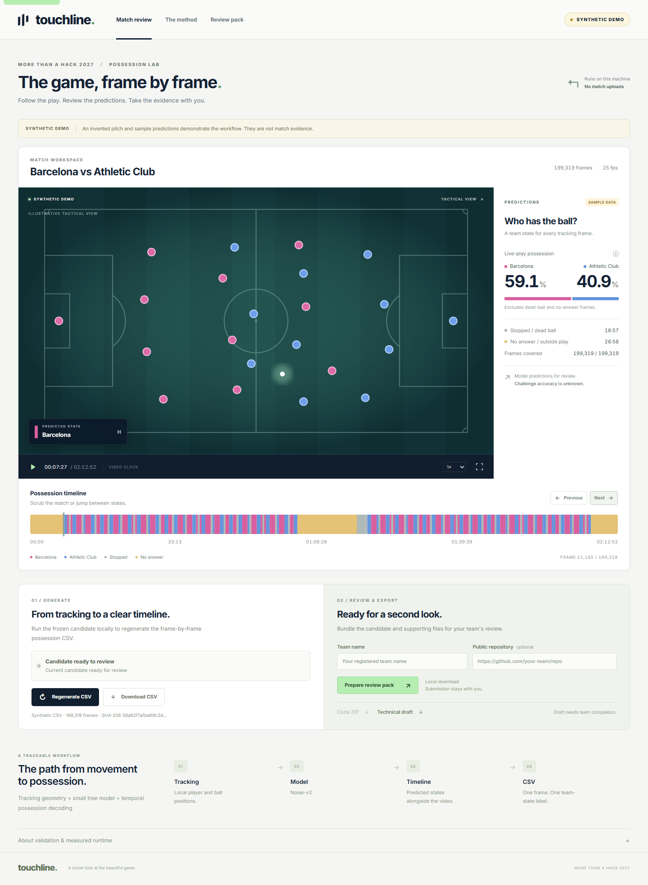

# Barcelona possession estimator

Private teammate code repository for the Barcelona hackathon. The working MVP
uses frozen **noise-v2** trees to turn tactical **tracking XML/TXT** into a
`frame,label` timeline: `H` home possession, `A` away possession, `D` dead ball,
and `X` outside active periods. The exact challenge contract is 199,319 ordered
frames, numbered 0 through 199318. Inference uses coordinates and observations;
video is optional for a human's authorized local review.



## Clone and run on Windows

Install Python 3.13 and Git. GitHub CLI is optional for cloning; access to this
private repository must already be granted to your GitHub account.

```powershell
gh repo clone kkamali04/barcelona-possession-hackathon -- --config core.autocrlf=false
cd barcelona-possession-hackathon
.\setup-git.ps1
py -3.13 -m venv .venv
.\.venv\Scripts\python.exe -m pip install -r requirements-lock.txt
.\review.ps1 -Demo
```

Open **http://127.0.0.1:8765**. The localhost dashboard shows an interactive pitch,
possession timeline, aggregate status, model/run controls and export controls.
DEMO mode invents the displayed match and output; it requires no match data and
does not measure football accuracy. Keep the process running; stop with Ctrl+C
or `.\stop-review.ps1`. Use `-Port 8767` if the default port is occupied.

Run these three focused runtime checks after installing the runtime requirements:

```powershell
.\.venv\Scripts\python.exe -m unittest discover -s tests -p test_decoder.py
.\.venv\Scripts\python.exe -m unittest discover -s tests -p test_pipeline.py
.\.venv\Scripts\python.exe -m unittest discover -s tests -p test_blind_final_contracts.py
```

## Use separately acquired authorized data

The repository contains **no tracking, videos, ground truth, actual predictions,
private review packs, external training matches, caches or environments**. Acquire
the competition assets separately through the organizer's authorized channel.
Place `BAR-ATH_tactical_atd.xml` and `BAR-ATH_tactical_atd.txt` in
`more-than-a-hack-2027-main/data/tactical/`. A tactical video is optional. Then:

```powershell
.\review.ps1
# Or infer directly, with explicit separate input root containing tactical/:
.\.venv\Scripts\python.exe tools/run_candidate.py --data-dir C:\authorized\data --out submissions/candidate.csv --report reports/local-candidate-run.json --no-cache
```

Outputs and restricted inputs stay local. The app validates the exact CSV
contract; format validation does not establish accuracy or competition acceptance.
Never print, attach to models or upload actual match inputs or prediction rows.
See [MVP_REVIEW.md](MVP_REVIEW.md) for the full local workflow.

## What has been measured

The accepted frozen MVP's **historical uncached single full-file inference** took
**53.7 seconds** and **114.0 MiB worker peak**, producing all 199,319 rows with
deterministic repeats and official validation. See its
[historical acceptance receipt](reports/mvp-final-root-acceptance-verification.json).
This is distinct from the **20m37s three-model v3 training stage**; that stage
included loading/feature preparation/assembly, three fits, export and parity.
It is not single-match inference time. No measured five-minute saving exists.

The isolated [speed reuse prototype](SPEED_REVIEW.md) measured about **2.2x** on
invented CPU preparation fixtures only. It is not integrated into the active
training runner or MVP; no actual full-stage or inference speedup is measured.
The included [fresh-run synthetic benchmark](benchmarks/speed_reuse/README.md)
is reproducible without the original private scratch directory.

The [v3 experiment](V3_REVIEW.md) tried turnover-aware decoding and broader
corruption training. **No candidate met its fixed eligibility gate.** It was not
promoted; fresh v3 test/package stages did not run. The frozen noise-v2 model
remains the default. Hidden-match performance is unknown.

## Code map and sharing boundary

| Path | Purpose |
| --- | --- |
| `possession_model/`, `models/` | Frozen numeric inference and selected model |
| `tools/run_candidate.py` | Tracking-to-CSV command |
| `review_app/`, `review.ps1` | Localhost review UI and demo |
| `experiments/v3/` | Closed, unpromoted research experiment |
| `experiments/speed_v1/`, `benchmarks/speed_reuse/` | Isolated exact-reuse prototype and invented-only harness |
| `research/`, `specs/`, selected `reports/` | Public-source design and aggregate historical evidence |
| `more-than-a-hack-2027-main/` | Retained organizer docs, loaders, validator and empty-output starter notebooks |

Runtime dependencies are pinned in `requirements-lock.txt`. Optional historical
fitting dependencies are in `requirements-training-lock.txt`; do not launch the
closed actual v3 study or treat this checkout as authorization for a new fit.
Some historical research links refer to intentionally excluded local evidence.
The public proposed dataset catalog is not an actual-study catalog or data grant.

The app's **code-only export** retains the original 106-member MVP scope and does
not include these added experiments/docs. Its **outer review ZIP is private**
because it contains a CSV. Never share that outer pack or actual timelines through
GitHub. This private repository is a teammate handoff; competition submission or
changing visibility needs separate owner authorization.

If you use that narrower code ZIP, extract it and run the Python environment,
dependency-install and `review.ps1 -Demo` commands above from its extracted root.
Skip Git clone and `setup-git.ps1`: Git safeguards, experiments, research and the
README screenshot belong to this extended repository. The ZIP includes
`MVP_REVIEW.md` for its standalone local runtime workflow.

[TEAM_REPO_MANIFEST.json](TEAM_REPO_MANIFEST.json) binds this extended curated
checkout. Legacy `PACKAGE_MANIFEST.json` binds its narrower runtime-export scope;
its README entry is refreshed for this teammate guide. Algorithm/model source
bytes and `ESTIMATOR_PACKAGE_MANIFEST.json` remain frozen. The original
`.gitignore` also stays frozen for export integrity; `.\setup-git.ps1` enables the
tracked [supplemental privacy rules](.gitignore.team), preserved size hooks and
`core.autocrlf=false` so frozen files keep their exact bytes across clones.
See [repository scope](docs/REPOSITORY_SCOPE.md), [THIRD_PARTY.md](THIRD_PARTY.md),
[SOLUTION.md](SOLUTION.md) and [current checkpoint](PROJECT_STATE.md).
