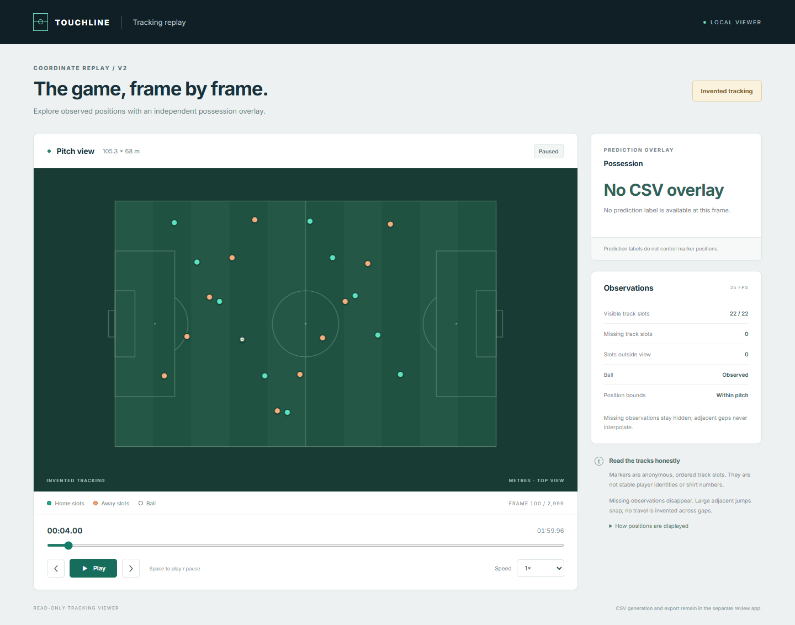

# Barcelona possession estimator

Estimate team possession from supplied tactical tracking, then replay the
coordinates with a possession overlay. The active estimator is frozen
**noise-v2**. It reads ATD XML/TXT and writes a `frame,label` CSV; it does not
understand video, identify players, or classify passes and shots.

## Windows quickstart — full Git repository

Install **Git** and **Python 3.13**, then clone with your authorized GitHub account:

```powershell
git clone --config core.autocrlf=false https://github.com/kkamali04/barcelona-possession-hackathon.git
cd barcelona-possession-hackathon
.\setup-git.ps1
py -3.13 -m venv .venv
.\.venv\Scripts\python.exe -m pip install -r requirements-lock.txt
.\replay.ps1 -Demo
```

If `py -3.13` is unavailable, use the full path to your installed Python 3.13
executable, for example `& 'C:\path\to\Python313\python.exe' -m venv .venv`.

macOS/Linux: with a Python 3.13 virtual environment and the same lockfile
dependencies installed, launch with `.venv/bin/python -m replay_v2 --demo --open`.

Open [localhost:8771](http://127.0.0.1:8771/), wait for preparation, then press
**Play**. The **Invented tracking** badge identifies the demo's generated
coordinates. Its possession panel shows **No CSV overlay**; no match download
is needed. Keep PowerShell running; stop with **Ctrl+C** or
`.\stop-replay.ps1` from another shell.



*Screenshot: invented demo tracking, with no CSV overlay.*

This quickstart requires the full repository. The legacy **106-member code-only
ZIP excludes `replay_v2`**; ZIP users should follow [MVP_REVIEW.md](MVP_REVIEW.md)
for its standalone review app instead.

## Supplied ATD → CSV → replay

Obtain match assets through the
[organizer's authorized download process](https://github.com/metrica-sports/more-than-a-hack-2027/blob/main/DATA.md#getting-it).
Replace the placeholder below with a data root containing
`tactical/BAR-ATH_tactical_atd.xml` and `tactical/BAR-ATH_tactical_atd.txt`:

```powershell
$DataRoot = 'C:\path\to\challenge\data'
.\run-candidate.ps1 --data-dir $DataRoot --no-cache
.\replay.ps1 -DataDir $DataRoot -Predictions '.\submissions\candidate.csv'
```

Inference writes `submissions/candidate.csv` and `reports/candidate-run.json`,
including the official format check. Replay opens with **Supplied tracking**;
opening it does not rerun inference. Omit `-Predictions` to view coordinates alone.
Inputs, CSVs, caches and environments stay local and outside Git. Model-facing
screenshots and browser tests must use invented data.

## Read the pitch and labels

- **Mint dots:** home track slots. **Peach dots:** away track slots.
  **Small white dot:** ball. Slots are anonymous, not shirt numbers or identities.
- Dots follow tracking observations. Missing observations disappear; supplied
  gaps and jumps remain. The CSV overlay does not move the dots.
- **H:** home possession, ball alive. **A:** away possession, ball alive.
  **D:** dead ball. **X:** no answer; play state is unspecified.

The [organizer's contract](https://github.com/metrica-sports/more-than-a-hack-2027/blob/main/CHALLENGE.md)
requires 199,319 ordered frames, numbered 0–199318. Format validity and a moving
replay do not establish possession accuracy; hidden-match performance is unknown.

## Further reading

[Viewer guide](docs/VIEWER_GUIDE.md) · [Replay commands and storage](REPLAY.md) ·
[Estimator details](SOLUTION.md) · [Repository scope](docs/REPOSITORY_SCOPE.md) ·
[Third-party sources](THIRD_PARTY.md)

Before editing, run `git pull --ff-only` and follow [AGENTS.md](AGENTS.md).
