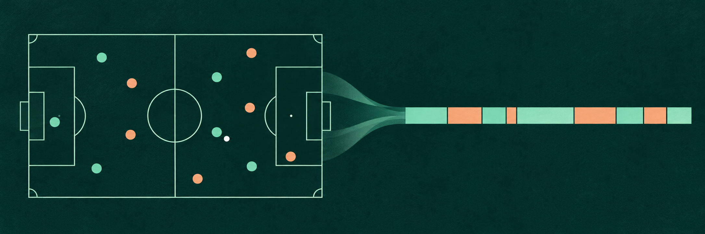
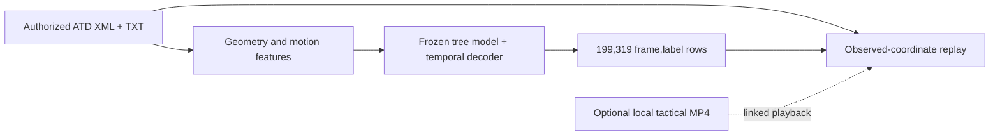

# Touchline · football possession from tracking

**ViscaElBarca** · More Than A Hack 2027 initial challenge



*Conceptual illustration; not match data or a screenshot.*

Estimate team possession from supplied tactical tracking, then replay the
coordinates with a possession overlay. The active estimator is frozen
**noise-v2**. It reads ATD XML/TXT and writes a `frame,label` CSV. It does not
understand video, identify players, or classify passes and shots.

**Start here:** [run the replay](#windows-quickstart--full-git-repository) ·
[make the submission CSV](#supplied-atd--csv--replay) ·
[understand the project](docs/PROJECT_MAP.md) ·
[work with an AI agent](docs/AGENT_GUIDE.md)



| What you get | What it does |
|---|---|
| **CPU inference** | Generates a label for every tactical frame with pinned dependencies and frozen weights |
| **Coordinate replay** | Natural or exact-sample motion, explicit missingness and an optional possession overlay |
| **Video comparison** | Link a local tactical MP4 to the replay clock, or open an independent Google Drive preview |
| **Reproducible handoff** | Includes the official validator, provenance, manifests and version-specific acceptance receipts |

The current viewing app is **`replay_v2`**. The older **`review_app` / Touchline
illustration has fixed player dots and an animated sample ball**; it is retained
for the original export, and is not a match replay. If an old page reports 404,
open the served replay address in a new tab or hard refresh. See
[Touchline troubleshooting](docs/TOUCHLINE.md).

## Windows quickstart — full Git repository

Install **Git** and **Python 3.13**, then clone:

```powershell
git clone --config core.autocrlf=false https://github.com/kkamali04/ViscaElBarca-Barcelona-hackathon.git
cd ViscaElBarca-Barcelona-hackathon
.\setup-git.ps1
py -3.13 -m venv .venv
.\.venv\Scripts\python.exe -m pip install -r requirements-lock.txt
.\replay.ps1 -Demo
```

If `py -3.13` is unavailable, use the full path to your installed Python 3.13
executable, for example `& 'C:\path\to\Python313\python.exe' -m venv .venv`.

macOS/Linux: with a Python 3.13 virtual environment and the same lockfile
dependencies installed, launch with `.venv/bin/python -m replay_v2 --demo --open`.

Open [localhost:8771](http://127.0.0.1:8771/), wait for preparation, then press
**Play**. The **Invented tracking** badge identifies the demo's generated
coordinates. Its possession panel shows **No CSV overlay**; no match download
is needed. Keep PowerShell running; stop with **Ctrl+C** or
`.\stop-replay.ps1` from another shell.

Use the launcher and local address; opening a static HTML file shows launch help.


*Screenshot: invented tracking and synthetic test-pattern video, with no CSV overlay.*

To compare the actual game, choose your local tactical MP4 in the viewer, then
check **Link controls — same tactical timeline** and leave offset **0** for the
full supplied recording. Files stay on your computer. A Drive share link can
open an **independent preview**; its controls are not synchronized.
See the [video and motion guide](docs/VIDEO_COMPARISON.md).

This quickstart requires the full repository. The legacy **106-member code-only
ZIP excludes `replay_v2`**; ZIP users should follow [MVP_REVIEW.md](MVP_REVIEW.md)
for its standalone review app instead.

## Supplied ATD → CSV → replay

Obtain match assets through the
[organizer's authorized download process](https://github.com/metrica-sports/more-than-a-hack-2027/blob/main/DATA.md#getting-it).
Replace the placeholder below with a data root containing
`tactical/BAR-ATH_tactical_atd.xml` and `tactical/BAR-ATH_tactical_atd.txt`:

```powershell
$DataRoot = 'C:\path\to\challenge\data'
.\start-match.ps1 -DataDir $DataRoot
```

This recomputes predictions from ATD with the frozen model, checks the format,
writes a fresh CSV/report under ignored `local/match-runs/`, then opens
**Supplied tracking** with that output attached. It does not use a precomputed
possession CSV as inference input. Choose another port with `-Port 8772` if needed.
Separate inference/replay commands remain in [REPLAY.md](REPLAY.md).
Inputs, CSVs, caches and environments stay local and outside Git. Model-facing
screenshots and browser tests must use invented data.

The organizer permits tracking-only algorithms. **A label for every frame is
required; decoding every video frame is optional.** Ground truth and hand-edited
match labels are forbidden training/tuning inputs. See the
[requirements and submission-readiness review](docs/REQUIREMENTS_AND_READINESS.md).

## Read the pitch and labels

- **Mint dots:** home track slots. **Peach dots:** away track slots.
  **Small white dot:** ball. Slots are anonymous, not shirt numbers or identities.
- Dots follow tracking observations. Missing observations disappear; supplied
  gaps and jumps remain. The CSV overlay does not move the dots.
- **H:** home possession, ball alive. **A:** away possession, ball alive.
  **D:** dead ball. **X:** no answer; play state is unspecified.

The [organizer's contract](https://github.com/metrica-sports/more-than-a-hack-2027/blob/main/CHALLENGE.md)
requires 199,319 ordered frames, numbered 0–199318. Format validity and a moving
replay do not establish possession accuracy; hidden-match performance is unknown.

## Further reading

- **Run and understand:** [viewer guide](docs/VIEWER_GUIDE.md),
  [replay commands and storage](REPLAY.md), [project map](docs/PROJECT_MAP.md).
- **Submit:** [readiness and exact requirements](docs/REQUIREMENTS_AND_READINESS.md),
  [technical document draft](docs/TECHNICAL_SUBMISSION.md),
  [morning review checklist](docs/MORNING_REVIEW.md).
- **Develop:** [agent guide](docs/AGENT_GUIDE.md), [estimator details](SOLUTION.md),
  [repository scope and manifests](docs/REPOSITORY_SCOPE.md),
  [third-party sources](THIRD_PARTY.md).

## Evidence and limits

The accepted November 17 replay release includes fresh-package ATD-to-CSV
checks, repeated deterministic output, the official format validator, independent
blind tests and local headless replay fidelity checks. In the recorded Windows
runs, full-match inference took **about 51 seconds** with **about 114 MiB peak
working set for the inference worker**. Initial replay-cache preparation adds
about 30 seconds; browser memory is separate. These are measurements of the
identified release, not a runtime or memory guarantee on another machine.
See the [versioned acceptance receipt](reports/overnight-acceptance.json).

**Hidden-match possession accuracy is unknown.** A valid CSV and moving dots
establish format and replay behavior, not ranking. Trained model provenance and
the disclosed organizer-published dead-play override are in
[SOLUTION.md](SOLUTION.md). The teammate's
[`safety/remove-match-specific-dead-label-20261117` branch](https://github.com/kkamali04/ViscaElBarca-Barcelona-hackathon/tree/safety/remove-match-specific-dead-label-20261117)
changes that inference behavior and requires its own acceptance; it is not silently
promoted by this documentation release.

The repository contains code, frozen model weights, invented screenshots and
selected aggregate evidence. **Download match data separately; never commit
match assets, generated prediction timelines, caches or private review packs.**
Historical experiments and reports remain available for traceability; the project
map distinguishes them from the selected workflow.

Before editing, run `git pull --ff-only` and follow [AGENTS.md](AGENTS.md).
