# Versioned possession challenger architecture

2026-11-15. Design revision4; **awaiting fresh independent design acceptance**.
Research acceptance (`reports/v3-research-root-verification.json`) permits design
synthesis only. Neither implementation nor new data access has passed its gate.

## Purpose and controlling artifacts

Implement and study both a genuine observation-dependent turnover decoder and
multi-match robustness training. The existing29-file fallback remains immutable.
This is an offline CPU challenger, not a replacement framework or public service.
`protocol.json` controls numeric choices, split, candidate IDs, seeds and budgets;
`contracts.md` controls typed interfaces and failure semantics; the two PRDs own
feature-specific motivations and acceptance scenarios. `tasks.md` controls status,
not scientific truth. A conflict blocks execution and is resolved before labels.

The study fixes A4: WOH+former-selectionWOY train; WPY fresh selection; WN1+WQQ
fresh test. WR9/WMX remain permanently closed. WOY becomes development forever;
its old selection evidence is retained as historical. SkillCorner, video models,
PELT, explicit-duration models and further curriculum searches are deferred.

## Components and flow

```mermaid
flowchart LR
  P[Protocol + immutable prior snapshot] --> G[Global live access guard]
  G --> A[Role-gated IDSSE parser]
  A --> O[Observations cache]
  A --> Y[Separate targets cache]
  O --> C[Deterministic corruption + dense features]
  C --> F[Two emitter fits + one shared boundary fit]
  Y --> F
  F --> S[One selection cohort; declared eight candidates]
  S --> Z[Freeze single eligible finalist]
  Z --> T[One reserved two-match test]
  T --> Q[Empirical quality verdict]
  Q --> E[Versioned exact-closure package]
  E --> B[Fresh blind process + synthetic UI acceptance]
  B --> R[Root promotion receipt or unchanged fallback]
```

The guard is a separate scientific-access boundary. An immutable history snapshot
is registered in study identity; a live cross-study consumption ledger decides
whether current access is allowed. A capability is checked on cache hits and raw
parser entry alike. Merely knowing a data path never grants a training/test role.
The earliest label-bearing raw parser is guarded, since coordinate preparation
can otherwise parse target fields before a later explicit target load.

Observations and targets are physically separate immutable cache members with
complete digests/schema validation. Inference and corruption receive only an
ObservationBatch/FeatureSet. Features use anonymous team aggregates; no target,
fixture identity, team name, event, true in-play cut or target-derived orientation
is predictive input. Full timelines and period reset boundaries survive missing
observations and unknown labels.

Training creates exactly three numerical models with one fixed seed: emitterC0
on clean/ball4/ball12/combined; emitterC1 on clean/ball4/combined/stale_players;
one boundary head on the C1 observations. The shared head remains identical in
all decoder ablations. Eight candidates are F080,B080,C0,C1,D0050,D0080,D1050,D1080.
F080 uses the accepted emitter/head/alpha.8 of B080 but flattens each support
type to its valid-incoming-edge mean per positive run. It is selection eligible;
B080-F080 is a selection-only timing-placement control, not an extra fit.
A is the unchanged comparator. All use the accepted base switching cost. C1-C0
isolates a curriculum replacement, not the standalone causal effect of stale
coordinates. Match-expansion and changed fits are not falsely described as an
isolated number-of-matches effect. Attribution is selection-only.

The new decoder computes typed edge costs on demand; it never stores an Nx3x3
matrix. Invalid boundary geometry recovers baseline costs. Alpha0 preserves the
accepted deterministic policy for numerically valid inputs; finite-arithmetic
overflow fails safely even when the accepted decoder would underflow. Tied paths obey canonical H-before-A ordering;
symmetry of chosen outputs is required only when the optimum is unique.

## Integration and protected state

All new runtime/training/control code lives in `experiments/v3/`. Existing
`possession_model`, noise-v2, review app, models/active.json, accepted CSV and ZIPs
remain byte-identical to `reports/v3-fallback-preservation.json`. Shared legacy
source is imported only through an explicit hashed dependency closure. The v3
adapter must not reuse the unsafe legacy cache-hit routine.

The scientific core.py predict_codes API must be implemented and frozen before fits;
evaluate.py and the release runner both call it with typed models/config/policy.
Public forcedD scores are constrained before decoding inside that core, not added
by a later wrapper. T09 owns versioned TECHNICAL.md/REPRODUCE.md included in export.
The new runner accepts an explicit finalist/release manifest; never silently
reads models/active.json as its selected challenger. That old config remains a
hashed comparator input. Export uses an exact list of files, never model/experiment
globs. The review bridge implements an isolated v3 ReviewState and server using
unchanged static assets and safe read-only helpers. It overrides hardcoded runner,
provenance and export assumptions rather than mutating the accepted server.
Separate output root, port8766 and explicit `python -m experiments.v3.review`
launcher keep the owner fallback available. No global monkeypatch is permitted.

A versioned package includes the exact v3 runtime, required accepted dependencies,
new numeric models, source/metric/protocol/license receipts and pinned runtime
lockfile. It excludes targets, tracking, footage, predicted timelines, train caches,
attempt logs with private data, all secrets and unrelated candidate models.
Private review bundles are separate, local, marked not-submitted; no publication.

## Failure and operational policy

One heavy process, four numeric threads,12GiB process-tree peak and8h aggregate fit
are hard ceilings. Added campaign disk target10GiB includes new originals and
scratch; preexisting originals are excluded from accounting but always protected.
Forecast before acquisition; abort before exceeding target or40GiB free space.
Do not delete originals to rescue a budget. No new paid compute or SDK installs.
Use the project CPython3.13 environment, never whichever bare python is first.

The strict schedule in protocol.json reserves time for acceptance: latest fit
start Nov 16 00:00, fit end08:00, selection start09:00, fresh test start12:00/end14:00,
first E2E gate by 17:00, final freeze20:00 New York. Missing a cutoff stops that new
stage. Complete available synthetic implementation/study evidence and retain the
fallback; do not call skipped training or pending gates complete. Root can finish
earlier. The milestone requires both ideas implemented/studied where gates permit,
not merely documents; inability is a recorded incomplete/failed campaign outcome.

Quality and efficiency are independent vetoes. A rejected or interrupted scientific
attempt cannot be repaired by retuning against its consumed test cohort. A purely
operational packaging repair may reuse unchanged scientific evidence only after
an independent byte/behavior-scope audit, followed by fresh exact-package acceptance.

Revision4 repair: roster/XML permutations canonicalize by home/away and unique
PersonId UTF-8 bytes before corruption. Exact source timestamps and canonical slot
identity remain in hashed observation cache metadata/members, never predictive
features. RNG has a fixed protocol root, distinct from source-integrity digests;
full logical Generator calls and final casts are normative. Arbitrary noncanonical
indexed batches reject. Primary pools H/A spells using official mean_f1; transition
diagnostics match independently per known run then pool counts. These are design
responses to root-reproduced round1 findings, awaiting a new G01, not code fixes.

Revision4 lifecycle: prefit study binds source/config/policy/environment/comparator;
new C0/C1/head artifacts receive a separate immutable postfit seal before selection,
then finalist binding before test and complete G08 rehash. Original study is never
rewritten. Standalone observation inference uses ReleaseAccess/InferenceContext,
without private study/control state; targets and study caches cannot use that path.
CSV/report/commit publish together as one immutable new directory; one directory
rename commits it. Versioned UI pins only validated complete generations, retaining
old output on failure. Static/server interfaces remain reusable; old state's
independent two-file replacements are not reused. FAQ exact hashed text establishes
the unchanged public forced-D interval. All changes still await fresh G01.
