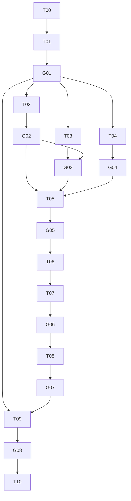

# Canonical task and gate tracker

Execution checkpoint: November16,2026,04:58UTC (design revision4). These IDs are shared by WORKFLOW/plan/protocol. Root alone
updates shared status/evidence; authors update only assigned deliverables.
`implemented_unaccepted` is not `accepted`. Research acceptance is not code/model
acceptance. G01-G05 are accepted within their recorded scopes; the actual fixed
study has completed acquisition and its single three-fit training attempt.
The single selection attempt completed with no eligible finalist. Independent
disposition/root acceptance and bounded owner handoff review are complete.
Actual v3 test and exact-package stages stopped at the eligibility rule.

| ID | Owner / bounded deliverable | Depends on | Status | Decisive evidence / next action |
|---|---|---|---|---|
| T00 | Research specialists: primary source/lane artifacts | None | research_accepted_for_design | reports/v3-research-root-verification.json; original archive preserved |
| T01 | Design authors: canonical docs + two PRDs | T00 | design_accepted | reports/v3-g01-root-acceptance.json; revision4 frozen evidence |
| G01 | Fresh independent scientific/binding critics; root reproduced actual probes | T01 frozen | accepted_for_synthetic_implementation | reports/v3-g01-root-acceptance.json; no code/model/resource acceptance implied |
| T02 | Guard implementer: contracts/guard/cli control path | G01 | implemented_accepted_bounded | reports/v3-g02-round4-root-acceptance.json; author44tests and independent/root8groups |
| G02 | Fresh blind guard tester; root verifies | T02 frozen | accepted_bounded_guard | reports/v3-g02-round4-root-acceptance.json; no data/science/package acceptance implied |
| T03 | Data implementer: cache/adapter/corruption/fetch | G01 | bounded_components_and_R6_synthetic_integration_accepted | reports/v3-cache-retry-bounded-root-acceptance.json; reports/v3-g05-root-acceptance.json; adversarial timing limitation retained |
| G03 | Fresh blind data/cache tester; root verifies | T03 frozen,G02 | accepted_bounded_round3 | Root reproduced27main+15TargetBatch checks; constructor-metadata limitation documented |
| T04 | Decoder implementer: boundary/decoder/numeric head | G01 | implemented_accepted_bounded_actual_study_ineligible | reports/v3-g04-root-acceptance.json; actual selection completed; no finalist |
| G04 | Fresh independent decoder/head/type critics; root reproduced | T04 frozen | accepted_bounded_code | reports/v3-g04-root-acceptance.json; later ObservationBatch-only repair goes through G02/G03/G05 |
| T05 | Integrator science/CLI + resource specialist in disjoint files | G02,G03,G04 | implemented_frozen_G05_synthetic_accepted_actual_study_ineligible | reports/v3-g05-root-acceptance.json; exact R6 source registered; actual training/selection complete |
| G05 | Fresh independent scientific/resource/cache critics; root verifies | T05 frozen | accepted_complete_synthetic_R6 | reports/v3-g05-root-acceptance.json;3fits54selection24test plus audits/refusals; no actualscience claim |
| T06 | Root-operated register/fetch/train | G05 | actual_three_fits_sealed_root_verified | reports/v3-actual-train-root.json;20m37s/788MiBworker;29fallbackunchanged |
| T07 | Root-operated selector: WPY all9includingA | T06 | actual_complete_no_eligible_finalist | reports/v3-selection-disposition-root-acceptance-r2.json;54rows/14m59s; root-r2 disposition accepted, no eligible finalist |
| G06 | Fresh independent selection-disposition audit; root verifies | T07 complete | accepted_no_eligible_finalist_root_r2 | reports/v3-selection-disposition-root-acceptance-r2.json;41347metadata checks; no fresh test authorized |
| T08 | Independent evaluator: one two-match test | G06 eligible | not_run_required_stop_no_eligible_finalist | Two fresh test matches remain unopened/unreserved; no gate relaxation |
| G07 | Independent scientific gate audit; root verifies | T08 complete | not_reached_no_eligible_finalist | No scientific export authorization or test-quality claim |
| T09 | Release specialist: runner/export/review/promotion + docs | G01; candidate afterG07 | restart_and_export_completeness_bounded_accepted_actual_release_stopped | reports/v3-export-completeness-root-acceptance.json;243independent/root metadata/export cases; no eligible candidate or actual authorization/E2E |
| G08 | Fresh blind exact-package/API/UI/resource testers | T09 frozen,G07 | actual_v3_E2E_not_run_eligibility_stop_tooling_bounded_accepted | reports/v3-native-measure-v5-strict-root-acceptance.json;29mock+30native/root; no actual candidate package |
| T10 | Root: evidence verification/local promotion or rejection | G08 or failed gate | rejection_accepted_bounded_handoff_review_complete | V3_REVIEW.md; reports/v3-handoff-claims-blind-final.json; independent/root no-finalist disposition; MVP/default29artifacts unchanged |

Parallel lanes after G01: T02,T03,T04 can implement against frozen interfaces using
invented fixtures only. T03 may not open actual label-bearing XML until G02/G03.
T05 integration waits for all three lane gates. T09 synthetic wrapper development
may overlap later compute in disjoint files, but only one heavy process runs.
Any material source/model/package repair re-enters its independent gate. Scientific
changes after test reservation cannot reuse that cohort. Failed/missed stages are
recorded failed/incomplete, never completed by paperwork.

Exact schedule is protocol.json.schedule: latest fit00:00/finish08:00, selection
start09:00, teststart12:00/end14:00, firstE2E17:00, freeze20:00 New York Nov 16.
Missed cutoff => no new dependent experimental stage; preserve working fallback
and accurately record which requested implementation/study work remains incomplete.
